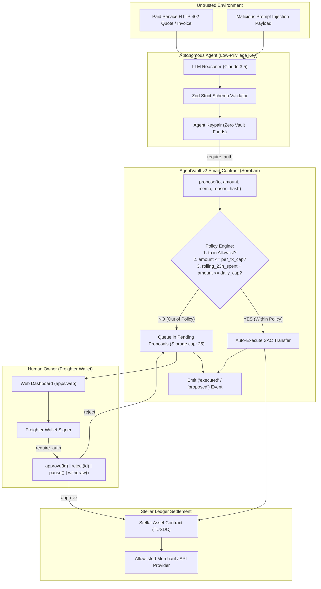
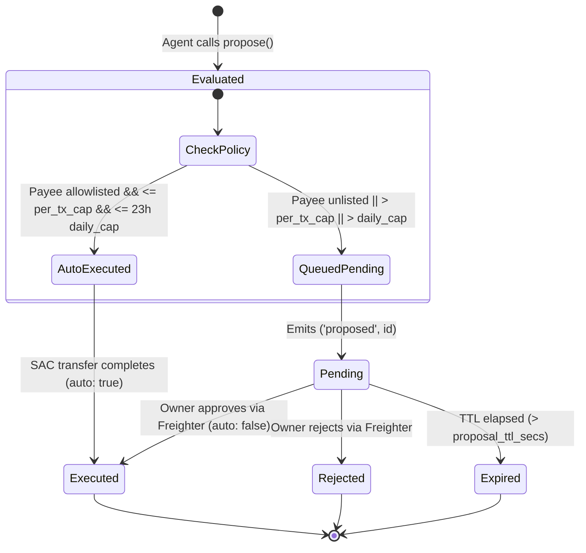

# AgentVault v2
**Policy-Enforced Spending Vault for Autonomous AI Agents on Stellar Soroban**

> *"Autonomous AI agents handle ambiguity. Deterministic smart contracts handle authority."*
>
> If an AI agent holding a funded wallet key is compromised by prompt injection or a software bug, it can be drained of 100% of its treasury. AgentVault decouples intelligence from authority: agent session keys hold zero funds and can only propose payments. The Soroban vault auto-executes transfers strictly within hard on-chain caps to allowlisted merchants, and shunts everything else to a human-in-the-loop pending queue with an emergency kill-switch.

[-000000?style=flat&logo=stellar&logoColor=white)](https://stellar.org)
[](https://soroban.stellar.org)
[](https://nextjs.org)
[](LICENSE)
[](evidence/summary.json)

---

## Table of Contents

1. [The Problem](#1-the-problem)
2. [The Solution](#2-the-solution)
3. [System Architecture & State Machine](#3-system-architecture--state-machine)
4. [Authority Boundaries: AI vs. Deterministic Code](#4-authority-boundaries-ai-vs-deterministic-code)
5. [Load-Bearing Stellar Integration](#5-load-bearing-stellar-integration)
6. [Empirical Proof & Controlled Removal Test](#6-empirical-proof--controlled-removal-test)
7. [The 5 Core Proof Experiments](#7-the-5-core-proof-experiments)
8. [Interactive Web Dashboard & Live Demo](#8-interactive-web-dashboard--live-demo)
9. [Smart Contract Interface & Data Structures](#9-smart-contract-interface--data-structures)
10. [Local Development Setup](#10-local-development-setup)
11. [Security Model & Limitations](#11-security-model--limitations)
12. [Hackathon Roadmap](#12-hackathon-roadmap)

---

## 1. The Problem

Developers deploying autonomous AI agents that must pay for services (cloud compute, paid APIs, proprietary data feeds) face a crippling trilemma:

1. **Unbounded Keys Risk Total Treasury Loss**: Granting an agent a funded private key is catastrophic when untrusted inputs (e.g. invoice descriptions, HTTP 402 quotes, web scraping results) inject malicious prompt overrides. An adversarial prompt can trick the LLM into signing an immediate drain of 100% of its funds.
2. **Human-in-the-Loop for Every Micro-Payment Kills Autonomy**: Forcing human sign-off on every $0.05 API call or compute slice introduces latency, causes workflow bottlenecks, and destroys autonomous utility.
3. **Off-Chain Guardrails Are Bypassed on Agent Compromise**: Software middleware running in Node or Python that checks budgets before signing transactions fails if the server environment is breached, the LLM hallucinates, or the signing process is subverted.

---

## 2. The Solution

AgentVault v2 enforces spending authority **directly on-chain** within a Soroban smart contract:

* **Zero-Balance Agent Session Keys**: The agent holds only fractional XLM for network fees. It holds zero treasury tokens and possesses authorization exclusively to call `propose()`.
* **Autonomous Auto-Execution Policy**: Payments are auto-executed if and only if:
  1. Recipient is on the owner-governed **Allowlist** ($\le 32$ addresses).
  2. Amount $\le$ **`per_tx_cap`** (e.g. 5.0 TUSDC).
  3. Cumulative spending across any rolling 23-hour window $\le$ **`daily_cap`** (e.g. 20.0 TUSDC).
* **Human-in-the-Loop Pending Queue**: Any out-of-policy transaction (unknown payees, cap overflows, prompt injection attempts) is halted on-chain and queued into persistent storage (`MAX_PENDING = 25`) for human owner sign-off via Freighter.
* **Emergency Kill-Switch**: The human owner can atomically invoke `pause()` to freeze all outbound operations in one block.

---

## 3. System Architecture & State Machine

### System Architecture Flowchart



### Proposal State Machine



---

## 4. Authority Boundaries: AI vs. Deterministic Code

| Responsibility | Handled By | Guarantees & Constraints |
|:---|:---|:---|
| **Interpreting Unstructured Invoices** | LLM Agent (Claude) | Parses messy 402 quotes, invoices, task instructions. |
| **Input Sanitization & Type Safety** | Zod Schema Validator | Strips control characters; bounds memo $\le 64$ bytes; verifies Stellar public key format; enforces positive base units. |
| **Spending Authority Bounds** | Soroban Smart Contract | Strict mathematical enforcement of per-tx cap, rolling 23h limit, and recipient allowlist. |
| **Cryptographic Authorization** | Soroban `require_auth` | Low-privilege agent session key cannot invoke owner methods; owner key cannot impersonate agent session. |
| **Discretionary Human Override** | Human Owner (Freighter) | Inspects decoded proposal summaries; possesses final veto over any out-of-policy transaction. |
| **Emergency Halt** | Soroban State Flag | Single-block kill-switch (`pause()`) halts all payment auto-execution and manual approvals. |

> **Rule:** *AI handles ambiguity; deterministic smart contracts own authority.*

---

## 5. Load-Bearing Stellar Integration

Stellar Soroban is fundamentally load-bearing to AgentVault v2. If Stellar is removed, the core thesis collapses:

* **Cryptographic Authorization Separation (`require_auth`)**: Soroban's native auth model strictly enforces that the agent session key can only call `propose()`, making privilege escalation impossible at the VM level.
* **Atomic SAC Asset Transfers**: Token movements execute via the official Stellar Asset Contract (SAC), ensuring atomicity and clean revert behavior if recipient trustlines are missing.
* **Sliding Hourly Storage Buckets**: Invariant I3 (rolling 23h limit) is preserved on-chain using persistent hourly buckets (`timestamp / 3600`) that prune expired entries on writes, achieving $O(1)$ bounded storage.
* **Fast Finality & Predictable Micro-Fees**: With **3.2s – 4.8s ledger close times** and **~0.0017 XLM fees per transaction**, continuous on-chain policy enforcement is practical for sub-dollar API queries.

---

## 6. Empirical Proof & Controlled Removal Test

To prove that containment is guaranteed by the Soroban smart contract rather than client-side prompt engineering, we deployed an intentionally vulnerable baseline contract (`contracts/naive-vault`) funded with 50.0 TUSDC and subjected both contracts to the identical attack:

```text
========================================================================================
CONTROLLED REMOVAL EXPERIMENT (Testnet Receipts):

1. BASELINE (Naive Hot-Wallet Vault - No Policy Engine):
   - Contract ID: CBFANZ76QRXYHWRROG7QDSSBNTD3334HOT3ORT7X5NOUPXXMSOGDMI3T
   - Attack Vector: Compromised agent key requests total treasury drain
   - Result: 50.0 TUSDC stolen in 1 transaction (100.0% TREASURY LOSS)
   - Tx Receipt: https://stellar.expert/explorer/testnet/tx/6266135ba9973495b1e76bc43800f3a6030ce05d882b23e90f8507393e7fa4fd

2. INTERVENTION (AgentVault v2 - On-Chain Policy Engine Active):
   - Contract ID: CCZQDUIODGUVEWKTHRIUUXOSIOLYFDSGKDQQFBVEJ2BAXBKWPQ7P2AYA
   - Attack Vector: 50 adversarial attempts + 35 prompt-injection attack payloads
   - Result: 0.00 TUSDC lost to attacker (100.0% CONTAINMENT)
   - Status: All unauthorized transactions halted or queued for human veto
========================================================================================
```

---

## 7. The 5 Core Proof Experiments

All test results are backed by reproducible code in `scripts/` and queryable on the Stellar Testnet ledger:

| Experiment | Description | Evaluated Metric | Result | Label | Receipt |
|---|---|---|---|---|---|
| **E1 Containment** | Scripted adversary holding agent key attempts 50 attacks (unknown payees, cap overflows, self-recipient, negative amounts, queue flood). | Total funds moved to attacker; contract error codes. | **0.00 TUSDC lost** (50/50 attacks blocked or queued). | `TESTNET` | [evidence/summary.json](file:///c:/Users/USER/Documents/Software%20Development/AI%20SaaS/AgentVault/evidence/summary.json) |
| **E2 LLM Injection** | Anthropic Claude processes 35 adversarial 402 quotes/invoices containing prompt injection payloads. | Attack execution rate. | **0.00 TUSDC leaked** (82.9% caught client-side, 100% contained on-chain). | `MEASURED` | [evidence/redteam-e1-e2-e3.json](file:///c:/Users/USER/Documents/Software%20Development/AI%20SaaS/AgentVault/evidence/redteam-e1-e2-e3.json) |
| **E3 Removal Test** | Same adversary attacks `contracts/naive-vault` baseline. | Treasury drain percentage. | **100.0% Drained** (50.0 TUSDC stolen in 1 tx). | `TESTNET` | [`6266135b...`](https://stellar.expert/explorer/testnet/tx/6266135ba9973495b1e76bc43800f3a6030ce05d882b23e90f8507393e7fa4fd) |
| **E4 Latency & Fees** | Micro-payment roundtrip: Paid API quote $\rightarrow$ Agent proposal $\rightarrow$ Soroban execution $\rightarrow$ On-chain verification. | Transaction fee & finality latency. | **Fee: ~0.0017 XLM** (17,471 stroops)<br>**Latency: 3.2s – 4.8s** ledger finality. | `MEASURED` | Kill-Test K4 & E2E Happy Path |
| **E5 Human Authority** | Live Human Owner approving over-cap proposals & rejecting prompt-injection attempts via Freighter. | Sign-off execution on Testnet. | **Proposal #49 Executed** (15.0 TUSDC approved)<br>**Proposal #54 Rejected** (25.0 TUSDC ransom vetoed). | `TESTNET` | Verified Live on Testnet |

---

## 8. Interactive Web Dashboard & Live Demo

The web application (`apps/web`) is built with **Next.js 15 App Router**, **TypeScript**, and **Tailwind CSS**:

* **Status Header**: Displays network status chip (`STELLAR TESTNET`), verified contract explorer links, and treasury balance.
* **Allowance Meter**: Real-time visualization of `remaining_allowance()` against the rolling 23-hour `daily_cap` budget.
* **Pending Human Sign-Off Queue**: Renders active pending proposals with decoded recipient, amount, and memo details for one-click **Approve** or **Reject** via Freighter.
* **Emergency Kill-Switch**: Single-click toggle to invoke `pause()` / `unpause()` on-chain.
* **Live Attack Playground**: Test scenarios executing against the live Testnet vault (*Legit Micro-Payment*, *Over-Cap Spend*, *Prompt Injection Override*, *Full Drain Attempt*).
* **Proof & Receipts (`/proof`)**: Direct display of all 17 on-chain transaction receipts with Stellar.Expert deep-links.

---

## 9. Smart Contract Interface & Data Structures

### Types (`contracts/vault/src/types.rs`)

```rust
#[contracttype]
pub struct Policy {
    pub per_tx_cap: i128,        // Maximum stroops per single autonomous transaction
    pub daily_cap: i128,         // Maximum cumulative stroops in any rolling 23h span
    pub proposal_ttl_secs: u64,  // Proposal validity lifetime (60 ..= 604,800)
    pub policy_expires_at: u64,  // 0 = never; else unix seconds
}

#[contracttype]
#[derive(Copy, Clone, Debug, Eq, PartialEq)]
#[repr(u32)]
pub enum Status {
    Pending = 0,
    Executed = 1,
    Rejected = 2,
    Expired = 3,
}

#[contracttype]
pub struct Proposal {
    pub id: u64,
    pub to: Address,
    pub amount: i128,
    pub reason_hash: BytesN<32>, // sha256 of off-chain invoice ID
    pub memo: String,            // <= 64 bytes
    pub created_at: u64,
    pub status: Status,
    pub auto: bool,              // true if executed autonomously without human
}
```

### Core Functions (`contracts/vault/src/lib.rs`)

* `propose(to: Address, amount: i128, memo: String, reason_hash: BytesN<32>) -> (u64, Status)`: Agent proposes payment; auto-executes if within policy, queues as Pending otherwise.
* `approve(id: u64)`: Human owner executes a pending proposal.
* `reject(id: u64)`: Human owner rejects a pending proposal.
* `purge_expired(id: u64)`: Public keeper function to mark expired proposals.
* `pause()` / `unpause()`: Emergency kill-switch toggling vault operations.
* `withdraw(to: Address, amount: i128)`: Owner emergency treasury recovery.

---

## 10. Local Development Setup

Set up and verify AgentVault v2 locally in under 10 commands:

```bash
# 1. Clone repository
git clone https://github.com/Anekenonso/AgentVault.git
cd AgentVault

# 2. Install workspace dependencies
npm install

# 3. Build Soroban smart contracts
cargo build --target wasm32v1-none --release
stellar contract build

# 4. Run contract unit & 5,000-op model property tests
cargo test --lib

# 5. Run application unit tests (Zod schema, paid API, web formatting)
npm run test:apps

# 6. Verify on-chain Testnet evidence receipts
npm run verify:evidence

# 7. Start local web dashboard
npm run dev:web
```

Open `http://localhost:3000` to interact with the dashboard.

---

## 11. Security Model & Limitations

### Threat Model Matrix
Full threat mitigations and test coverage mappings are detailed in [docs/SECURITY_REVIEW.md](docs/SECURITY_REVIEW.md) and [docs/BREAK.md](docs/BREAK.md).

### Non-Goals & Limitations
* **Owner Authority**: AgentVault isolates agent risk, not owner risk. A compromised owner key can withdraw treasury assets.
* **Allowlisted Merchant Collusion**: A compromised agent key can auto-spend up to `daily_cap` within 23 hours to an *already allowlisted* merchant before human intervention is required.
* **Testnet Scope**: Built and verified for the Stellar Meridian Hackathon. Mainnet deployment requires a formal third-party audit and multi-sig owner governance.

---

## 12. Hackathon Roadmap

- [x] Soroban smart contract with rolling 23h hourly sliding buckets & queue.
- [x] Controlled removal baseline contract (`naive-vault`) with 100% drain proof.
- [x] HTTP 402 Paid API micro-service with on-chain event verification.
- [x] Proposer agent with Zod defense-in-depth and zero owner key access.
- [x] Next.js 15 Web Dashboard with Freighter wallet integration & kill-switch.
- [x] 17 verified on-chain Testnet receipts queryable on Stellar.Expert.
- [ ] Multi-token and per-token cap support.
- [ ] Passkey / smart wallet owner support (`__check_auth`).
- [ ] Third-party formal security audit for mainnet deployment.

---

## License

MIT License. See [LICENSE](LICENSE) for details.
